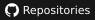
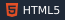
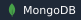
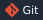
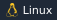

# Md. Tanjim Mahtab Taosif

**Full Stack Web Developer**

I build fast, accessible, production-ready web apps across the React and Vue ecosystems, 
from the interface down to the API and the database.

  
  
  

 

## About

- Building real-world full stack applications with **Next.js** and **Nuxt**
- Focused on performance, clean architecture, and scalable state management
- Open to collaborating on interesting full stack and frontend projects
- Ask me about React, Next.js, Vue, Nuxt, Pinia, Tailwind CSS, or the MERN stack

## Tech Stack

<table>
  <tr>
    <td valign="top" width="160"><b>Frameworks</b></td>
    <td>
      
      
      
      
    </td>
  </tr>
  <tr>
    <td valign="top"><b>State & Auth</b></td>
    <td>
      
      
    </td>
  </tr>
  <tr>
    <td valign="top"><b>Languages & UI</b></td>
    <td>
      
      
      
      
    </td>
  </tr>
  <tr>
    <td valign="top"><b>Backend & Data</b></td>
    <td>
      
      
      
      
    </td>
  </tr>
  <tr>
    <td valign="top"><b>Tools</b></td>
    <td>
      
      
      
      
    </td>
  </tr>
</table>

## GitHub Activity

  <picture>
    <source media="(prefers-color-scheme: dark)" srcset="https://github-profile-summary-cards.vercel.app/api/cards/profile-details?username=tanjimtaosif&theme=github_dark" />
    
  </picture>
  <picture>
    <source media="(prefers-color-scheme: dark)" srcset="https://github-profile-summary-cards.vercel.app/api/cards/stats?username=tanjimtaosif&theme=github_dark" />
    
  </picture>
  <picture>
    <source media="(prefers-color-scheme: dark)" srcset="https://github-profile-summary-cards.vercel.app/api/cards/repos-per-language?username=tanjimtaosif&theme=github_dark" />
    
  </picture>

 

  Open to ideas and collaborations. Reach out on <a href="https://www.linkedin.com/in/tanjimtaosif/">LinkedIn</a> or <a href="https://x.com/tanjim_taosif">X</a>.

